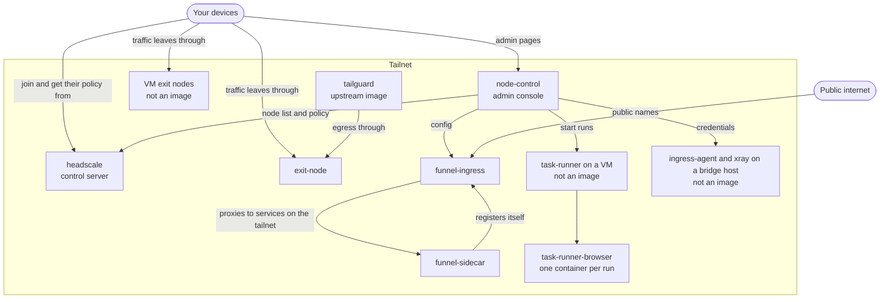

# Container images and how they fit together

CI publishes six images to `ghcr.io/valentinalexeev/headlamp/<image>`. A few more parts run directly on hosts. Together they make up a self-hosted tailnet: a control server, exit nodes, an admin console and optional public ingress. This page says what each image does, where it runs and what it needs from you.

For tags and release rules, see [`VERSIONING.md`](../VERSIONING.md). The list CI builds from is [`.github/components.json`](../.github/components.json).

## The whole picture



Every node, image or not, joins the tailnet through headscale. `exit-node`, `node-control`, `funnel-ingress` and `funnel-sidecar` each join as a tailnet node of their own. The diagram leaves those links out, and the cloud provider APIs node-control calls to start and stop VMs.

## Images

| Image | What it does | Where it runs | Needed? |
|---|---|---|---|
| `headscale` | The control server: who is on the tailnet and what they may reach | One Fly machine | Yes |
| `exit-node` | A tailnet exit node, with routes for chosen hostnames that always leave through it | A Fly machine | No, if VM exit nodes are enough |
| `node-control` | The admin console and API: start and stop nodes, enrol devices, manage policy, Funnel config and tasks | One machine, reachable only over the tailnet | Strongly recommended, and required by `funnel-ingress` and task-runner |
| `funnel-ingress` | Publishes tailnet services under public names, as a reverse proxy | A public Fly machine | Only for public ingress |
| `funnel-sidecar` | Registers one service with `funnel-ingress` from Kubernetes, with no special privileges | Beside your workload | Only for Kubernetes services |
| `task-runner-browser` | The Chromium and Playwright container each scheduled browser check runs in | On a VM, started by task-runner under rootless podman | Only for tasks and browser sessions |

### What each one needs

The images are generic. Where a site's settings belong they hold placeholders, or nothing at all, so **none of them runs usefully without your configuration**.

| Image | You supply | State it keeps |
|---|---|---|
| `headscale` | `headscale.yaml` and `acl.json`, replacing the placeholders in the image | Its database, on a volume |
| `exit-node` | Auth key, `direct-hosts.txt`, and optional state encryption settings | Tailscale identity, on a volume or encrypted in Redis |
| `node-control` | Environment settings, cloud credentials, `headscale` API key, and optional `app/nodes.json` and `app/enroll.json` | Enrolment, policy and tasks data, in files or Redis depending on what you enable |
| `funnel-ingress` | Environment settings and an auth key | Its tailnet identity and registered routes; namespaces and blocks come from node-control |
| `funnel-sidecar` | Environment settings naming the namespace and service | None: its node is ephemeral |
| `task-runner-browser` | Nothing: the caller sends each script | None: each container is thrown away |

Each app's README has the full settings.

## Parts that are not images

| Part | How it runs | Why it has no image |
|---|---|---|
| VM exit nodes | Terraform creates them, and the Ansible roles configure them | They are machines, not containers |
| `ingress-agent` | A systemd service, installed by Ansible on a bridge host | It restarts xray through systemd and owns xray's config on the host |
| `task-runner` | A binary on a VM, installed by Ansible | It starts containers itself, under its own locked-down user |
| `tailguard` | Docker Compose, run by you | It uses the upstream `ghcr.io/juhovh/tailguard` image plus scripts from this repo |

CI still runs the tests for `ingress-agent` and `task-runner`.

## How a request flows

**A device using an exit node.** The device joins through `headscale`, which gives it the policy and the list of peers. Its traffic then goes directly to the exit node over WireGuard. `headscale` carries no user traffic.

**Starting a node from the console.** Over the tailnet, you open `node-control`, which calls the cloud provider to start the VM and checks `headscale` to see when it is back online.

**A public request.** A visitor reaches `funnel-ingress` at `<service>.<namespace>.<domain>`. It looks up the route and proxies over the tailnet to the node serving it. That node may be a `funnel-sidecar`, or any tagged node that registered itself. `node-control` holds the namespaces and blocks, and `funnel-ingress` pulls them.

**A scheduled check.** `node-control` sends a script to `task-runner` on a VM. `task-runner` starts a throwaway `task-runner-browser` container, runs the script, and returns a small JSON result.

## Using the images

Your settings stay in your private repo, as with any other part of this project, and are added on top of the image. A thin Dockerfile does this and keeps the deployment pinned:

```dockerfile
FROM ghcr.io/valentinalexeev/headlamp/node-control:1.2.3@sha256:<digest>
COPY app ./app
```

Pin the digest as well as the version. Before the first release, only the `main` and `sha-<commit>` tags exist.

Two things do not use the published images yet:

- `fly/deploy.sh` in [`examples/private-repo/`](../examples/private-repo/) still builds from source, with your files laid over the app directory. That keeps working.
- The `task-runner` Ansible role builds the browser image on each node, or loads a `podman save` archive for nodes that cannot reach a registry. Set `task_runner_base_image` for the first, or `task_runner_image_archive` for the second.

All images are `linux/amd64` for now.
