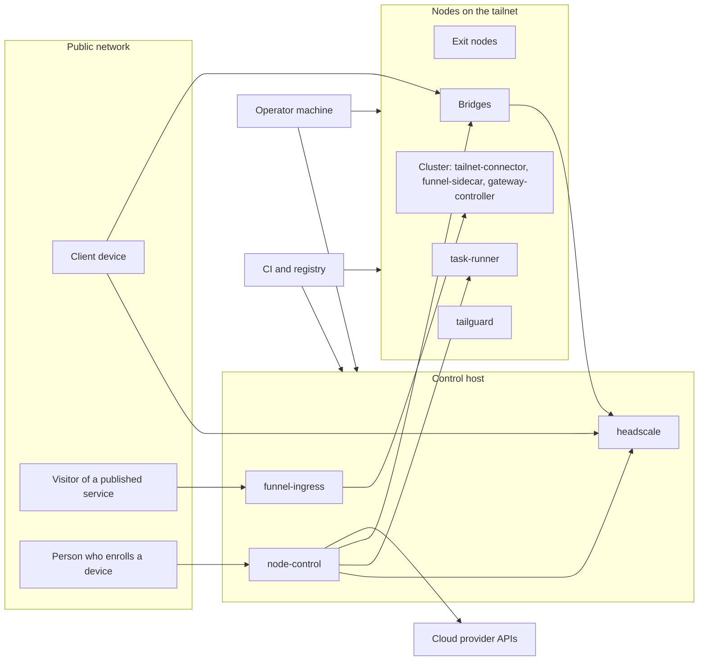

# Threat model

This page is the threat model of headlamp. It lists what an attacker can want, who the attacker can be, and where the trust boundaries are. The security review (#363) uses this page as its plan.

Status: draft. The review is not complete. This page gives no result for a threat. A threat in this page is a question for the review. It is not a known defect.

## Scope

The model includes all the code of this repository:

- the images of `apps/`,
- the roles of `ansible/`,
- the modules of `terraform/`,
- the charts of `charts/`,
- the scripts of `scripts/`,
- the build and release process of `.github/`.

The model also includes the upstream projects `headscale` and `tailscale`, as dependencies. The review does not examine their code. It examines how headlamp uses them.

The model does not include these items:

- the settings and the secrets of a site, which are in the private repository of that site,
- the security of the cloud accounts of a site,
- the cryptography of WireGuard and of the tailnet control protocol,
- an attacker with physical access to a host.

## The system

| Component | Function | Where it runs |
|---|---|---|
| `headscale` | Control server of the tailnet. It holds the node list, the keys and the policy. | Control host |
| `node-control` | Console and API for the administrator. It starts and stops nodes, enrolls devices, edits the policy and runs tasks. | Control host, as a tailnet node |
| `funnel-ingress` | Public reverse proxy into the tailnet. | Control host, as a tailnet node |
| `exit-node` and the VM exit nodes | Send the traffic of clients to the public network. | Container host or VM |
| Bridges (`reality-ingress`, `ingress-agent`) | Accept clients from a restricted network and connect them to the tailnet. | VM |
| `task-runner` | Runs one browser script in a container for `node-control`. | VM exit node |
| `tailnet-connector`, `funnel-sidecar`, `gateway-controller` | Connect a Kubernetes cluster to the tailnet and publish its Services. | Cluster |
| `tailguard` | WireGuard server that sends traffic through an exit node. | Docker host of the operator |
| Operator machine | Holds the private repository, the `age` key and the cloud credentials. Runs Terraform and Ansible. | Workstation |
| CI and registry | Build, test and publish the images and the charts. | Hosted |

## Assets

| ID | Asset | Why an attacker wants it |
|---|---|---|
| A1 | Access to the tailnet as a node | Reach the services of other nodes. Use an exit node. |
| A2 | The tailnet policy | Decide which node can reach which service. |
| A3 | The `headscale` database and its keys | Change or add a node. Take the identity of the control server. |
| A4 | The `headscale` API key | Do all `headscale` administration: nodes, users, pre-auth keys, policy. |
| A5 | Pre-auth keys and node keys | Add a node, or take the identity of a node. |
| A6 | The administrator functions of `node-control` | Control nodes, enrolment, policy, tasks and published services. |
| A7 | Cloud credentials | Start, stop, change or delete VMs. Cause cost. |
| A8 | The state keys and the sealed state | Read or change stored secrets and identities. |
| A9 | The traffic of clients on exit nodes and bridges | Read metadata. Change the traffic. |
| A10 | Names and topology | Learn which hosts, services, users and applications exist. |
| A11 | Availability of the control server, the nodes and the public listeners | Stop the service. Cause cost. |
| A12 | Enrolment links, subscription secrets and OIDC sessions | Enroll a device as a different person. |
| A13 | Task scripts and task secrets | Read credentials of external services. Run code on a node. |
| A14 | Audit records and logs | Hide an attack. |
| A15 | The source, the build process, the images and the charts | Put code into all deployments. |
| A16 | The `age` key, the Terraform state and the SSH CA key | Read all secrets of a site. Get a shell on its hosts. |

## Attackers

| ID | Attacker | Start position |
|---|---|---|
| V1 | External, zero knowledge | Can reach the public listeners. Knows only public information, which includes this repository. |
| V2 | Internal, full knowledge | A valid user or node of the tailnet with no administrator role. Knows the deployment. |
| V3 | Hybrid | V1 and V2 work together. The insider gives information or one action, and the outsider does the attack. |
| V4 | Compromised client | Controls the software or the platform of a valid device. Holds its node key and its user session. |
| V5 | Poisoned control node | Controls one server component: `headscale`, `node-control`, `funnel-ingress`, a bridge or an exit node. |
| V6 | Dependency | Controls a third-party input: a Go module, a base image, a downloaded binary, an action, an upstream release. |

A compromised administrator account is the limit of V4. The model examines what limits the damage and what records it.

## Trust boundaries

| ID | Boundary | What crosses it |
|---|---|---|
| B1 | Public network to `headscale` | Node registration, the control protocol, the API, relay and STUN traffic |
| B2 | Public network to the enrolment listener of `node-control` | Enrolment links, subscriptions, OIDC login |
| B3 | Public network to `funnel-ingress` | HTTP requests for published services |
| B4 | Public network to a bridge | Client connections, certificate requests, proxied enrolment paths |
| B5 | Public network to an exit node or `tailguard` | WireGuard packets, SSH if the site opens it |
| B6 | Tailnet user to the console of `node-control` | Administrator requests, with the identity that the tailnet gives |
| B7 | Tailnet node to a machine API | Registration at `funnel-ingress`, certificate and config requests at `node-control` |
| B8 | `node-control` to `headscale` | The API key |
| B9 | `node-control` to a node agent (`task-runner`, `ingress-agent`) | A token, scripts, secrets, bridge settings |
| B10 | `node-control` to the cloud provider APIs | Cloud credentials |
| B11 | A component to its state store | Sealed state in Redis, SQLite or a volume |
| B12 | Task script to its host | Code of the caller in a container |
| B13 | Cluster to the tailnet | Routes into the Service network, published Services, the Kubernetes API permissions of the controller |
| B14 | Operator machine to the hosts and the cloud | SSH, Terraform, Ansible, deploy commands |
| B15 | Contributor to the main branch | Pull requests, reviews, branch rules |
| B16 | Source to the published artifacts | CI jobs, the registry, release tags |
| B17 | Upstream to the build and to the nodes | Modules, base images, binaries that a build or a role downloads |
| B18 | The site DNS and the public CAs to the deployment | Names of published services, certificates |

## Entry points

| Listener | Component | Reachable from | Caller identity |
|---|---|---|---|
| HTTPS control and API | `headscale` | Public network | Machine key for a node. API key for the API. |
| Relay and STUN | `headscale` | Public network | Node key for the relay. None for STUN. |
| Console and API, port 80 | `node-control` | Tailnet | Tailnet identity of the caller, then roles |
| Machine routes | `node-control` | Tailnet | Tailnet identity, then a tag |
| Enrolment, port 8081 and an optional plain listener | `node-control` | Public network, through a proxy | Token in the URL, or an OIDC session |
| DNS, port 53 | `node-control` | Tailnet | None. Rules use the tailnet identity. |
| Health and metrics | `node-control` | As the site binds them | None |
| Public proxy | `funnel-ingress` | Public network, through a TLS edge | None. The Host header selects the service. |
| Registration API, port 9100 | `funnel-ingress` | Tailnet | Tailnet identity, then tags |
| Service listeners and `/readyz` | `funnel-sidecar` | Tailnet, and the pod network for `/readyz` | The tailnet policy |
| Runner API and session port | `task-runner` | Tailnet | Bearer token. A token for each session. |
| Agent API | `ingress-agent` | Tailnet | Bearer token |
| Client ports 443 (TCP and UDP) and 80 | Bridge | Public network | Client credential of the protocol. None on port 80. |
| WireGuard port | Exit node, `tailguard` | Public network | WireGuard key |
| SSH | VM nodes, control host | As the site opens it | SSH key or certificate |
| Workflows | CI | Contributors | Repository permissions |

## Threats

Each threat has an ID. The review gives each threat a result (see "Method").

### Access to the tailnet and its services

| ID | Threat | Boundary |
|---|---|---|
| T1 | A person gets a pre-auth key or an enrolment link of a different person and adds a node. | B1, B2 |
| T2 | A node gets a tag that it must not have, and the policy gives it more access. | B1, B7, B8 |
| T3 | A route that a node advertises takes traffic that must go to a different node. | B1, B13 |
| T4 | A published service gives the public network a path to a service that the owner did not publish. | B3, B7, B13 |
| T5 | A bridge gives its clients a path to tailnet addresses that the policy does not permit. | B4 |
| T6 | A task script or a browser session reaches the host, the tailnet or the metadata service. | B12 |
| T7 | A stolen node key or node state lets an attacker take the identity of a node. | B11, B14 |
| T8 | A default policy or a default setting gives more access than the administrator expects. | B1, B6 |

### Information disclosure

| ID | Threat | Boundary |
|---|---|---|
| T9 | A public listener shows the names of hosts, services, users or namespaces. | B2, B3, B4, B18 |
| T10 | Public records (DNS, certificate logs, image metadata) show the topology. | B16, B18 |
| T11 | A health, metrics or error response shows internal data. | All listeners |
| T12 | A log, a process list or instance metadata holds a secret. | B9, B11, B14 |
| T13 | A tailnet user without a role reads data of the console or of DNS. | B6 |
| T14 | A bridge or an exit node reads or keeps the metadata of client traffic. | B4, B5 |

### Denial of service and cost

| ID | Threat | Boundary |
|---|---|---|
| T15 | Requests without a limit use all the capacity of a public listener. | B1, B2, B3, B4 |
| T16 | An attacker stops or deletes nodes through the console or the cloud credentials. | B6, B10 |
| T17 | An attacker starts many nodes, tasks, sessions or certificates and causes cost or a rate limit. | B6, B9, B10, B18 |
| T18 | A policy change or a state change locks out all users, the administrator included. | B6, B8, B11 |
| T19 | A loss of the control host or of its state stops the tailnet, with no recovery path. | B11 |

### Privilege escalation

| ID | Threat | Boundary |
|---|---|---|
| T20 | A tailnet user without a role does an administrator action. | B6 |
| T21 | A web page that the administrator opens sends a request to the console. | B6 |
| T22 | An administrator of one module gets the rights of a different module, or the full `headscale` API. | B6, B8 |
| T23 | A compromised component uses its credentials outside its function. | B8, B9, B10, B13 |
| T24 | A compromised node agent or container gets root on its host. | B9, B12 |
| T25 | A compromised controller in a cluster gets cluster administrator rights. | B13 |
| T26 | A compromised VM reads cloud credentials or secrets through its instance identity. | B10 |

### Integrity of the product and of the evidence

| ID | Threat | Boundary |
|---|---|---|
| T27 | A change gets into the main branch or a release without the review of the owner. | B15 |
| T28 | A CI job publishes an artifact that is not the build of the reviewed source. | B16 |
| T29 | A dependency, a base image or a downloaded binary carries hostile code. | B17 |
| T30 | A deployment runs an artifact that the operator cannot verify. | B16, B17 |
| T31 | An attacker changes or removes audit records and logs. | B11 |
| T32 | A secret of the operator machine leaks: the `age` key, the state, the SSH CA key. | B14 |

## Matrix of targets and attackers

Each cell lists the threats that the review must examine for that pair. The review can add a threat to a cell.

| Target | V1 external | V2 internal | V3 hybrid | V4 client | V5 control node | V6 dependency |
|---|---|---|---|---|---|---|
| Access to tailnet services | T1, T4, T5, T8 | T2, T3, T8 | T1, T4 | T2, T3, T7 | T2, T3, T6, T7 | T29 |
| Information disclosure | T9, T10, T11 | T11, T13 | T9, T12 | T12, T13 | T12, T14 | T29 |
| Denial of service and cost | T15 | T15, T16, T17 | T15, T17 | T16, T17, T18 | T16, T18, T19 | T29, T30 |
| Privilege escalation | T21 | T20, T22 | T21, T22 | T20, T21, T22 | T23, T24, T25, T26 | T29 |
| Product and evidence | T27, T28 | T31 | T27, T31 | T31, T32 | T31 | T28, T29, T30 |

## Requirements of the administrator

The ticket gives three requirements. The review examines each one against all the threats.

| ID | Requirement | Question for the review |
|---|---|---|
| R1 | Monitor the security condition of the deployment. | Which events does each component record? Can the administrator see a new node, a tag change, a policy change, a failed login and a refused request? |
| R2 | Secure the deployment when the risk increases. | Which controls can the administrator tighten without a new release? How fast can the administrator revoke a key, a node, a link or a role? |
| R3 | Collect evidence that an attacker did not change. | Where are the audit records? How long do they stay? Can a compromised component change them? Can the administrator export them? |

## Assumptions

The review tests these assumptions. It does not accept them as facts.

- The tailnet identity that `tsnet` gives for a caller is correct while `headscale` is not compromised.
- A tag is as trustworthy as the `tagOwners` section of the policy.
- The TLS edge in front of a public listener sets the client address correctly.
- The state key and the `age` key are not on a host that an attacker controls.
- The operator applies the roles and the modules without a local change.

## Method

1. Divide the code into parts by trust boundary. Each part gets one issue.
2. For each part, one reviewer reads the code and tries each threat of its boundaries.
3. A second reviewer, who did not see the work of the first, tries to disprove each finding.
4. Give each threat of the part one result:

   | Result | Meaning |
   |---|---|
   | Not applicable | The threat cannot occur in this part. The record gives the reason. |
   | Mitigated | A control stops the threat. The record names the control and its test. |
   | Finding | The threat can occur. The record gives the conditions, the effect and a proposed fix. |

5. Give each finding a severity:

   | Severity | Meaning |
   |---|---|
   | Critical | V1 gets A1 to A8 or A15, with no action of a user. |
   | High | V1 with an action of a user, or V2, gets A1 to A8, A13 or A15. |
   | Medium | Disclosure of A10, loss of A11, or an escalation that needs V4 or V5. |
   | Low | A missing defence layer with no direct attack path. |

6. Record the finding as the owner decides in #363. Do not write the details of a finding in a public place before that decision.

The review is complete when each cell of the matrix has a result for each of its threats.

## Keep this page current

Change this page in the same pull request when a change does one of these things:

- adds or removes a listener or a port,
- adds a credential, or gives a component a new use of a credential,
- adds a component, a state store or an external service,
- changes who can call an API.
